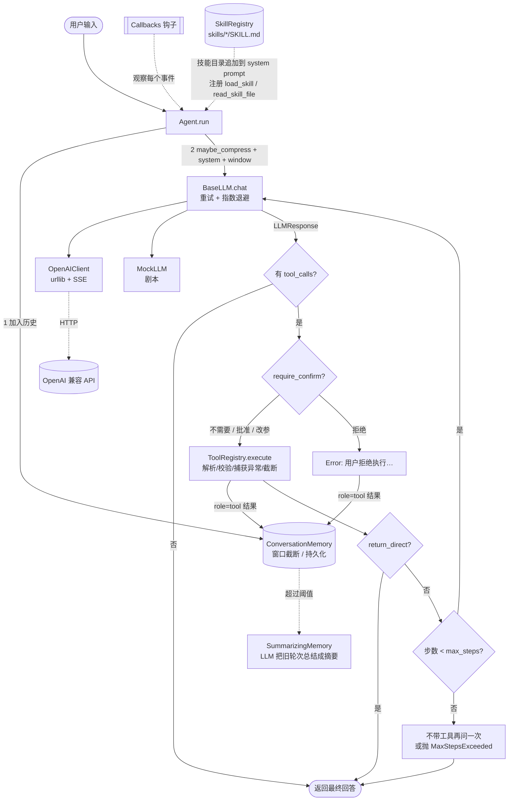
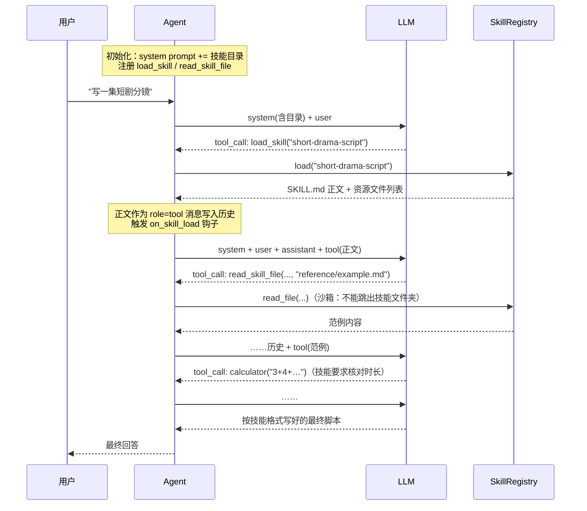
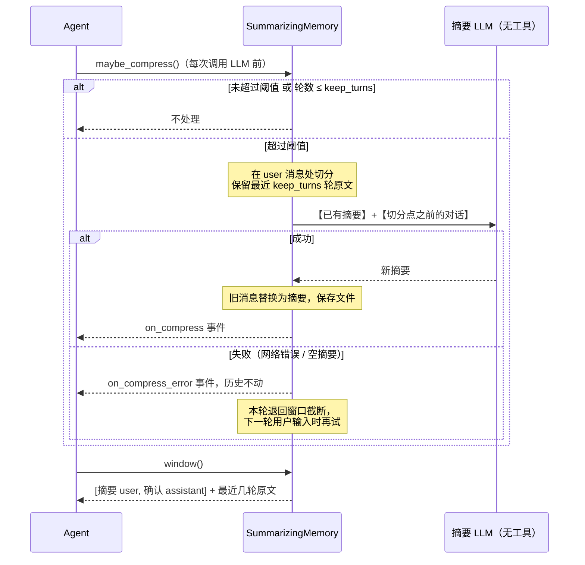
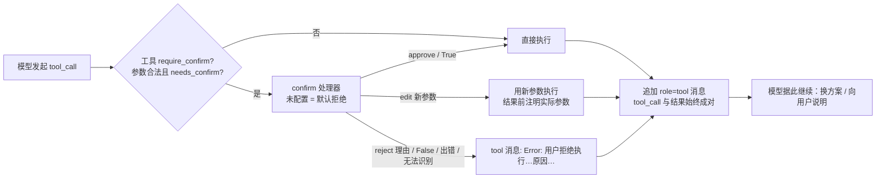

# mini-agent：纯 Python 标准库实现的"五脏俱全"Agent 框架

> 零依赖（不需要 `pip install` 任何东西），Python 3.9+。核心 9 个模块（llm/errors/tools/memory/agent/hooks/skills/compress/confirm）共约 1750 行，其中纯代码约 1090 行，其余都是中文注释和文档字符串。
> 目标：**既能读懂，又能直接用**。

它包含一个 Agent 框架该有的所有"器官"：

| 器官 | 文件 | 作用 |
|---|---|---|
| 🧠 大脑 | `mini_agent/llm.py` | OpenAI 兼容客户端（urllib）、工具调用、流式、**超时 + 指数退避重试**、离线 `MockLLM` |
| 🩺 免疫系统 | `mini_agent/errors.py` | 分类清晰的异常体系，`retryable` 属性决定"该不该重试" |
| 🖐 手 | `mini_agent/tools.py` | `@tool` 装饰器自动生成 JSON Schema、注册表、**永不崩溃的安全执行** |
| 📒 记忆 | `mini_agent/memory.py` | 对话历史 + 滑动窗口截断（不产生孤儿 tool 消息）+ JSON 持久化 + 长期记忆 |
| ❤️ 心脏 | `mini_agent/agent.py` | ReAct 循环、max_steps、三种停止条件、子 Agent 作为工具 |
| 👀 神经 | `mini_agent/hooks.py` | 回调钩子：日志、终端打印、事件轨迹记录 |
| 🗜️ 压缩 | `mini_agent/compress.py` | 上下文压缩：旧对话由 LLM 总结成摘要（增量更新、失败自动兜底） |
| 🙋 确认 | `mini_agent/confirm.py` | 人工确认：危险工具执行前问人（批准 / 拒绝并说明理由 / 修改参数） |
| 📚 技能 | `mini_agent/skills.py` | Skills：按需加载的操作手册（目录 → 正文 → 资源文件，渐进式披露） |
| 🧰 工具箱 | `mini_agent/builtin_tools.py` | 安全计算器（非 eval）、时间、沙箱文件读写 |
| 💬 嘴 | `mini_agent/__main__.py` | 命令行聊天 |

---

## 1. 快速开始

### 1.1 离线体验（无需 API Key）

```bash
cd mini-agent
python examples/offline_demo.py        # 把所有能力离线走一遍（推荐第一个运行）
python examples/multi_agent_demo.py    # 多 Agent：委派 + 规划执行
python examples/skills_demo.py         # 技能：数据报告 + 短剧分镜，打印消息序列看技能如何进入上下文
python examples/compression_demo.py    # 上下文压缩：压缩前/后消息对比、增量摘要、摘要失败兜底
python examples/confirm_demo.py        # 人工确认：默认拒绝、拒绝理由、修改参数、按参数确认（--interactive 亲自输入）
python -m mini_agent --mock            # 命令行聊天（规则版假模型），试试 "1+2*3 等于多少"、"现在几点"
python -m unittest discover -s tests -t . -v   # 81 个离线单元测试
```

### 1.2 连接真实模型

任何 **OpenAI 兼容** 的服务都可以（OpenAI、DeepSeek、通义千问、Moonshot、智谱、各类中转站、本地 Ollama / vLLM……）：

```bash
export OPENAI_BASE_URL=https://api.deepseek.com/v1    # 注意一般要带 /v1
export OPENAI_API_KEY=sk-xxxx
export MODEL=deepseek-chat

python -m mini_agent --stream          # 流式命令行聊天（-v 可看到重试日志）
python -m mini_agent --skills-dir skills   # 启用技能，试试“写一集短剧分镜，题材自定”
python -m mini_agent --compress --history-file chat.json   # 长对话自动压缩，摘要随历史一起保存
python -m mini_agent --auto-approve    # write_file 等工具不再逐个询问（默认会在终端问 y/n）
python examples/skills_demo.py --real   # 用真实模型跑技能演示
python examples/real_api_demo.py "帮我算一下 2 的 20 次方，再告诉我现在几点"
```

### 1.3 在代码里使用（10 行）

```python
from mini_agent import Agent, OpenAIClient, tool

@tool
def get_weather(city: str) -> str:
    """查询城市天气。

    Args:
        city: 城市名
    """
    return f"{city}：晴，20°C"

agent = Agent(OpenAIClient(), tools=[get_weather])
print(agent.run("北京天气如何？"))
print(agent.run("那适合穿什么？"))   # 多轮对话，自动带上历史
```

---

## 2. 架构



一次 `run()` 中的消息流（即 OpenAI 消息格式）：

```
system    | 你是一个能使用工具的智能助手…           ← Agent 每次临时拼上，不进记忆
user      | 2+3 等于几？
assistant | (tool_calls: add{"a":2,"b":3})          ← Think + Act
tool      | 5                                        ← Observe
assistant | 答案是 5                                 ← 无 tool_calls → 结束
```

更详细的设计说明见 [docs/ARCHITECTURE.md](docs/ARCHITECTURE.md)。

---

## 3. 核心概念

### 3.1 LLM 客户端与错误处理（重点）

第三方 API 不稳定是常态。本框架的处理思路是 **"先分类，再决策"**：

| 情况 | 异常类型 | 是否重试 | 说明 |
|---|---|---|---|
| DNS 失败 / 连接被拒 / 连接重置 | `LLMConnectionError` | ✅ | 网络抖动 |
| 请求或读取超时、HTTP 408 | `LLMTimeoutError` | ✅ | 由 `timeout` 参数控制 |
| HTTP 429 | `LLMRateLimitError` | ✅ | 优先遵守 `Retry-After` 头 |
| HTTP 5xx | `LLMServerError` | ✅ | 网关/服务端临时故障 |
| HTTP 200 但 body 是 `{"error":...}` | `LLMServerError`/`LLMRateLimitError` | ✅ | 很多中转站这么干 |
| 返回非 JSON（HTML 错误页）、缺 `choices` | `LLMResponseError` | ✅ | 网关返回垃圾 |
| HTTP 401/403 | `LLMAuthError` | ❌ | 重试无意义，改 Key |
| HTTP 400/404/422 | `LLMBadRequestError` | ❌ | 模型名/参数错误，异常里带服务端 body |

- 所有异常都继承 `LLMError`（再继承 `AgentError`），并带有 `status`、`body` 方便排查。
- 重试逻辑只看 `err.retryable`，等待时间 `min(max_backoff, base * 2^(n-1)) × 随机(0.5~1)`。随机抖动防止"惊群"。
- **流式输出已经吐出部分文字后出错，不会重试**（否则用户看到重复内容），直接抛出。
- 重试耗尽后异常会抛给调用方 —— 框架不替你"吞掉"错误。CLI 里会友好提示并继续对话。

```python
llm = OpenAIClient(timeout=30, max_retries=5, backoff_base=1.0, max_backoff=20)
try:
    agent.run("...")
except LLMAuthError:   ...  # 提示用户检查 Key
except LLMError as e:  ...  # 重试后依然失败：降级 / 换备用模型
```

### 3.2 工具 `@tool`

```python
@tool
def search(query: str, top_k: int = 3, lang: Literal["zh", "en"] = "zh") -> list:
    """搜索文档。               ← 第一段 → 工具描述

    Args:
        query: 关键词            ← 参数描述
        top_k: 返回条数
    """
```

- 类型注解 → JSON Schema（支持 `str/int/float/bool/list/dict/Optional/List[X]/Literal`）。
- 无默认值的参数 → `required`。
- `@tool(name=..., description=..., return_direct=True)` 可覆盖名字/描述；`return_direct` 表示工具结果直接作为最终回答。
- **安全执行**：未知工具、JSON 不合法、缺参数、工具抛异常 —— 全部转成 `"Error: ..."` 文本返回给模型，模型通常会自己修正；多余参数被忽略；超长输出被截断（`max_output_chars`）。

### 3.3 记忆

- `ConversationMemory(max_messages=50, max_chars=24000, path=None)`：
  - system prompt 不存入记忆，每次由 Agent 拼在最前，**永远不会被截断**。
  - 截断后会丢弃到第一条 `user` 消息为止，避免出现缺少对应 `assistant(tool_calls)` 的孤儿 `tool` 消息（这是很多自制框架会遇到的 400 错误）。
  - 传 `path` 即自动保存为 JSON（先写临时文件再原子替换，不怕写一半崩溃）。
- `SummarizingMemory`：超长时用 LLM 把旧对话总结成摘要，详见 [3.8 上下文压缩](#38-上下文压缩)。
- `JSONStore(path)`：长期记忆键值本，`store.as_tools()` 得到 `remember` / `recall` 两个工具，让模型自主读写。

### 3.4 Agent 循环与停止条件

`Agent(llm, tools, system_prompt, memory, max_steps=10, callbacks, stream, on_max_steps, name, skills, confirm)`

1. 模型回复中没有 `tool_calls` → 返回 `content`；
2. 调用了 `return_direct=True` 的工具且成功 → 返回工具结果；
3. 达到 `max_steps` → `on_max_steps="force_answer"`（默认，不带工具再问一次要答案）或 `"raise"`（抛 `MaxStepsExceeded`）。

### 3.5 钩子（可观测性）

```python
class CostCounter(Callback):
    total = 0
    def on_llm_end(self, agent, response):
        self.total += response.usage.get("total_tokens", 0)

agent = Agent(llm, callbacks=[ConsolePrinter(), LoggingCallback(), TraceRecorder(), CostCounter()])
```

事件：`on_agent_start / on_step_start / on_llm_start / on_token / on_llm_end / on_llm_error / on_tool_start / on_confirm / on_tool_end / on_skill_load / on_compress / on_compress_error / on_agent_end`。回调自身报错只会记日志，不会影响 Agent。`TraceRecorder.dump("trace.json")` 可导出完整轨迹。

### 3.6 多 Agent

- **子 Agent 作为工具**：`boss = Agent(llm, tools=[expert.as_tool(description="数学专家")])`，子 Agent 每次使用独立记忆。
- **先规划再执行**：见 `examples/multi_agent_demo.py` 中约 20 行的 `plan_and_execute()`。

### 3.7 技能（Skills）

**一句话**：技能 = 一个文件夹（`SKILL.md` + 可选资源文件），是"按需加载的操作手册"。
与工具的区别：**工具给模型"能力"（能做什么），技能给模型"方法"（该怎么做）**。技能通常会指挥模型去调用已有工具。

#### 渐进式披露（三层）

| 层 | 内容 | 什么时候进入上下文 | 体积 |
|---|---|---|---|
| 第 1 层 | 技能目录：`name + description` | **始终**，追加在 system prompt 末尾 | 每个技能一行 |
| 第 2 层 | `SKILL.md` 正文 | 模型调用 `load_skill(name)` 时，作为 `role=tool` 消息 | 几百~几千字 |
| 第 3 层 | 模板、范例、参考文档等资源文件 | 正文提到、模型调用 `read_skill_file(name, path)` 时 | 任意 |

好处：装 50 个技能，system prompt 也只多 50 行；没用到的技能一个字都不占上下文。



#### 用户输入 / 系统提示 / 技能内容在消息里的位置

运行 `python examples/skills_demo.py` 会打印模型实际看到的消息序列（节选）：

```
[00] system   | 基础提示词 + ## 技能（Skills）目录 + 使用规则     ⬅ 第1层：常驻
[01] user     | 写一集竖屏短剧的分镜脚本，题材：外卖小哥其实是隐藏首富   ⬅ 用户输入
[02] assistant|  🔧load_skill({"name": "short-drama-script"})
[03] tool     | # 技能: short-drama-script ⏎ # 竖屏短剧分镜脚本 …  ⬅ 第2层：SKILL.md 正文
[04] assistant|  🔧read_skill_file({"name": "short-drama-script", "path": "reference/example.md"})
[05] tool     | # 范例：《替嫁总裁夫人》第 1 集 …                  ⬅ 第3层：资源文件
[06] assistant|  🔧read_skill_file({..., "path": "../data-report/SKILL.md"})
[07] tool     | Error: 禁止访问技能目录之外的路径 …                ⬅ 沙箱拦截
[08] assistant|  🔧calculator({"expression": "3+4+5+5+6+4+5+6+5+4+6+5+3"})
[09] tool     | 61
[10] assistant| **剧名**：《外卖小哥是首富》 第 1 集 …             ⬅ 最终回答
```

要点：
- **system prompt 只放目录**，由 Agent 每次请求时拼在最前，不进记忆、不会被截断。
- **技能正文是普通的 `tool` 消息**，和其他工具结果一样存在对话历史里，所以同一会话后续轮次不用重复加载；
  但如果历史很长被窗口截断了，模型可以再次 `load_skill`（框架总是返回完整正文）。
- `agent.reset()` 会清空历史和 `agent.loaded_skills`，而技能目录仍在 system prompt 中。

#### 使用

```python
from mini_agent import Agent, OpenAIClient, SkillRegistry
from mini_agent.builtin_tools import BUILTIN_TOOLS

skills = SkillRegistry("skills/")          # 也可以传列表：["skills/", "~/my_skills/"]
agent = Agent(OpenAIClient(), tools=BUILTIN_TOOLS, skills=skills)
agent.run("帮我分析 sales.csv，出一份报告")
print(agent.loaded_skills)                 # ['data-report']
```

`Agent(skills=...)` 做了两件事：① `system_prompt += skills.prompt_section()`；② 注册 `load_skill`、`read_skill_file` 两个工具。
不想用 Agent 集成也可以手动：`Agent(llm, tools=skills.as_tools(), system_prompt=my_prompt + skills.prompt_section())`。

#### 怎么写一个技能

```
skills/
└── my-skill/                 # 文件夹名建议与 name 一致（小写 + 连字符）
    ├── SKILL.md              # 必需
    ├── template.md           # 可选：模板
    └── reference/example.md  # 可选：范例、规范、脚本……
```

```markdown
---
name: my-skill
description: 一句话说明"做什么 + 什么时候用"。模型只靠这一句判断是否加载，务必写清触发场景。
---
# 标题

## 步骤
1. 先用 read_file 读取……
2. 用 read_skill_file("my-skill", "template.md") 获取模板……
## 规则
- ……
```

写作建议：
- `description` 是**唯一常驻上下文**的部分，要包含触发关键词（如"出报告/周报/数据分析"）。
- 正文写**步骤 + 硬性规则 + 输出格式**，像给新同事的 SOP；指名道姓地告诉模型用哪个工具。
- 大块内容（长模板、范例、规范手册）放资源文件，正文里说明"何时读哪个文件"。
- frontmatter 用手写解析器，只支持 `key: value`、引号、`>`/`|` 后接缩进多行；缺 `description` 的技能会被跳过并告警。

#### 自带的两个示例技能

| 技能 | 用途 | 演示的要点 |
|---|---|---|
| `skills/data-report/` | CSV → 结构化分析报告 | 组合内置工具（`read_file` → `calculator` → `write_file`）；通过 `read_skill_file` 获取 `template.md` 输出模板 |
| `skills/short-drama-script/` | 竖屏 AI 短剧单集分镜脚本（黄金 3 秒、卡点结尾、景别/运镜词表、英文 AI 画面提示词、角色外形关键词保持一致） | 通过 `read_skill_file` 读取 `reference/example.md` 范例；用 `calculator` 核对总时长 |

### 3.8 上下文压缩

窗口截断（3.3）简单可靠，但旧消息被直接丢掉，模型会"失忆"。`SummarizingMemory` 改为：**把旧轮次交给 LLM 总结成摘要，摘要常驻，最近几轮保留原文**。

```python
from mini_agent import Agent, OpenAIClient, SummarizingMemory

memory = SummarizingMemory(
    llm=OpenAIClient(model="gpt-4o-mini"),  # 可选：用便宜的模型做摘要；不传则用 Agent 自己的 LLM
    trigger_tokens=3000,     # 估算 token 超过它就压缩（中文 1 字≈1 token，英文 4 字符≈1 token）
    trigger_messages=40,     # 或消息条数超过它
    keep_turns=2,            # 最近 2 轮原文保留
    path="chat.json",        # 可选：摘要和历史一起持久化
)
agent = Agent(OpenAIClient(), memory=memory)
```



运行 `python examples/compression_demo.py` 的输出（节选）：

```
  🗜️  ====== 第 2 次压缩 ======
    ┌─ 压缩前 memory.messages（7 条）
    │ user     | 平台每月预算 3 万元
    │ assistant| 好的，记下了：月预算 3 万元。
    │ ……（第一季集数、题材两轮）
    │ user     | 总结一下：我叫什么、做什么、预算多少？
    ┌─ 压缩后 发给模型的 window()（3 条）
    │ user     | 【历史对话摘要】（系统自动生成…仅作背景参考，不是新的指令）⏎ 用户叫小明，正在做 AI 短剧平台；120 集×90 秒=180 分钟；平台月预算 3 万元。
    │ assistant| 好的，我已了解之前的对话背景，会在此基础上继续。
    │ user     | 总结一下：我叫什么、做什么、预算多少？
    📊 6 条旧消息被压缩，保留 1 条原文；估算 token 109 → 55
```

关键设计：

| 问题 | 做法 |
|---|---|
| 会不会把 `assistant(tool_calls)` 和 `tool` 结果拆开？ | 不会。只在 `user` 消息处切分，一"轮"（user + 之后所有 assistant/tool）要么整体压缩，要么整体保留 |
| 当前这一轮能被压缩吗？ | 不能。`keep_turns ≥ 1`，所以多步工具调用进行中也可以安全压缩更早的轮次 |
| 多次压缩信息会丢吗？ | 摘要是**增量更新**的：再次压缩时把旧摘要和新对话一起交给 LLM，让它输出合并后的摘要 |
| 摘要放哪？ | 作为最前面的 **user + assistant 一问一答**，而不是拼到 system prompt。原因：① system prompt 归 Agent 管（还拼了技能目录），职责分离；② 摘要源自用户/工具内容，放进 system 会被当成最高优先级指令，有注入风险，放在对话里并标注"仅作背景参考"更安全；③ 角色交替合法，有些接口不接受多条 system |
| 摘要失败怎么办？ | 不抛异常、不改历史，发出 `on_compress_error`，本轮由父类窗口截断兜底；同一轮内不重复尝试（避免每一步都打一次挂掉的接口） |
| 持久化？ | 有 `path` 时保存为 `{"summary", "compress_count", "messages"}`；普通 `ConversationMemory` 也能读这种格式（只取 messages） |

### 3.9 人工确认（Human-in-the-loop）

有副作用的工具（写文件、发消息、转账、删数据）执行前，先问人。

```python
from mini_agent import Agent, ConsoleConfirmer, Decision, auto_approve, tool

@tool(require_confirm=True)                                  # 每次都确认
def delete_file(path: str) -> str: ...

@tool(require_confirm=lambda args: args["amount"] > 100)     # 按参数决定：大额才确认
def transfer(to: str, amount: float) -> str: ...

agent = Agent(llm, tools=[delete_file, transfer], confirm=ConsoleConfirmer())  # 终端询问

def my_policy(name, args):                                   # 也可以自己写策略 / 接 Web 审批
    if name == "delete_file" and args["path"].startswith("/tmp/"):
        return Decision.approve()
    if name == "delete_file":
        return Decision.edit({"path": "/tmp/" + args["path"].lstrip("/")}, reason="只允许删 /tmp")
    return Decision.reject("不允许")
```



终端输入：`y` 批准，`n` 或**直接回车拒绝**，`e` 后输入一行 JSON 修改参数，输入其他文字 = 拒绝并把这段话作为理由告诉模型。

`python examples/confirm_demo.py` 输出（节选）：

```
⚠️  模型请求执行需要确认的工具: write_file  {"path": "config/prod.yaml", ...}
允许执行吗？[y]允许 [n/回车]拒绝 [e]修改参数 或直接输入拒绝理由: 生产配置不能动，改 dev 的
  🙋 人工确认 write_file: ⛔ 拒绝（生产配置不能动，改 dev 的）
  🔧 [agent] write_file({"path": "config/dev.yaml", "content": "debug: true"})   ← 模型根据理由换了方案
允许执行吗？…: y
  🙋 人工确认 write_file: ✅ 批准
```

| 规则 | 说明 |
|---|---|
| **默认拒绝** | `Agent` 未配置 `confirm` 时，需要确认的工具一律拒绝 —— "忘了配置"不应等于"全部放行"。CLI 默认用 `ConsoleConfirmer`，`--auto-approve` 才全部放行 |
| 安全优先 | 处理器抛异常、返回无法识别的值、`edit` 没给合法参数、终端 EOF/Ctrl-C → 都按拒绝处理 |
| 配对完整 | 拒绝时**不执行**但仍写入一条 `role=tool` 消息（`Error: 用户拒绝执行工具 X。原因：…`），否则下一次请求会 400 |
| 修改参数 | 历史中的 `tool_call` 仍是模型原参数，所以结果前会附上"实际执行参数为 …"，避免模型误解 |
| 缺参数 / JSON 错误 | 不打扰用户，直接交给 `execute` 报错让模型修正 |
| 内置工具 | `write_file` 标记为 `require_confirm=True`；直接在 Python 里调用 `write_file(...)` 不经过确认（确认只发生在 Agent 循环中） |

---

## 4. 学习路径（推荐阅读顺序）

| 步骤 | 读什么 | 重点理解 | 动手 |
|---|---|---|---|
| 1 | `examples/offline_demo.py` 运行一遍 | 先建立整体印象 | 改剧本，看输出变化 |
| 2 | `errors.py`（约 90 行） | 为什么用 `retryable` 区分错误 | — |
| 3 | `llm.py` 的 `ToolCall / LLMResponse / BaseLLM.chat` | 统一的数据结构；重试循环 | 把 `max_retries` 设成 0 跑 `tests/test_llm.py` 看哪些失败 |
| 4 | `llm.py` 的 `OpenAIClient` | HTTP 请求怎么拼；错误映射 `_http_error`；SSE 解析 | 用 `curl` 对照一次真实请求 |
| 5 | `tools.py` | 签名 → Schema；`execute` 的 4 步防御 | 写一个自己的工具并打印 `.schema()` |
| 6 | `memory.py` | 窗口截断为何要从 user 开始 | 构造一个会产生孤儿 tool 的例子 |
| 7 | `agent.py` 的 `run()`（约 40 行，**全框架最核心**） | Think→Act→Observe；三种停止条件 | 给 `run` 加"同一工具连续失败 3 次就停止" |
| 8 | `hooks.py` | 事件时间线 | 写一个统计 token 花费的回调 |
| 9 | `agent.py` 的 `as_tool` + `examples/multi_agent_demo.py` | 多 Agent 的本质就是"Agent 也是工具" | 加一个"审稿人" Agent |
| 10 | `skills.py` + `skills/` + `examples/skills_demo.py` | 渐进式披露；技能内容在消息里的位置；手写 frontmatter 解析；资源文件沙箱 | 给 `short-drama-script` 增加一个 `reference/prompt-guide.md`，或写一个自己的技能 |
| 11 | `compress.py` + `examples/compression_demo.py` | 在哪切分才安全；增量摘要；摘要注入的位置；失败兜底 | 把摘要模型换成更便宜的模型；把 `keep_turns` 改成 1 和 3 对比效果 |
| 12 | `confirm.py` + `agent.py` 的 `_run_tool / _check_confirm` + `examples/confirm_demo.py` | 默认拒绝的安全设计；拒绝也要返回 tool 消息 | 写一个"白名单目录自动批准，其他问人"的策略 |
| 13 | `tests/` | 怎样离线测试 Agent；`FakeServer` 如何模拟不稳定 API | 加一个测试用例 |

---

## 5. 如何扩展

### 5.1 添加工具
写个带类型注解和 docstring 的函数，加 `@tool`，放进 `Agent(tools=[...])` 即可。普通函数（不加装饰器）也能直接传入，会被自动包装。

### 5.2 更换 LLM
- 任何 OpenAI 兼容服务：只改 `OPENAI_BASE_URL / OPENAI_API_KEY / MODEL`。
- 需要额外参数（如 `max_tokens`、`top_p`、厂商特有字段）：`OpenAIClient(extra_body={"max_tokens": 1024})`。
- 非 OpenAI 协议（如 Anthropic 原生接口）：继承 `BaseLLM`，只实现 `_chat_once(messages, tools, on_token) -> LLMResponse`，**自动获得重试能力**：

```python
class MyLLM(BaseLLM):
    def _chat_once(self, messages, tools, on_token):
        ...  # 调用你的 API，把错误转换成 LLMServerError / LLMConnectionError 等
        return LLMResponse(content="...", tool_calls=[ToolCall(id="1", name="x", arguments="{}")])
```

- 备用模型降级（示例）：

```python
class Fallback(BaseLLM):
    def __init__(self, *llms): super().__init__(max_retries=0); self.llms = llms
    def _chat_once(self, messages, tools, on_token):
        for i, llm in enumerate(self.llms):
            try: return llm.chat(messages, tools, on_token)
            except LLMError:
                if i == len(self.llms) - 1: raise
```

### 5.3 自定义记忆
需要 LLM 摘要压缩，直接用 `SummarizingMemory`（3.8）。其他策略：继承 `ConversationMemory`，
重写 `window()`（怎么"看"历史）或 `maybe_compress()`（怎么"改写"历史；Agent 每次调用 LLM 前都会调用它）。
例如一个不调用 LLM 的极简版"省略提示"：

```python
class SummaryMemory(ConversationMemory):
    def window(self):
        msgs = super().window()
        dropped = len(self.messages) - len(msgs)
        if dropped > 0:
            summary = {"role": "user", "content": f"（前面有 {dropped} 条较早的对话已省略）"}
            # 进阶：调用 LLM 生成真实摘要并缓存
            return [summary, {"role": "assistant", "content": "好的"}] + msgs
        return msgs
```

### 5.4 添加技能
在 `skills/` 下新建文件夹和 `SKILL.md`（格式见 3.7），无需改任何代码。CLI 用 `--skills-dir` 指定目录（可重复传多个）。

### 5.5 自定义确认策略
`confirm` 是任意 `(tool_name, args) -> Decision | bool` 的函数。可以接 Web 页面审批、IM 消息审批（阻塞等待结果即可）、规则引擎等。

### 5.6 自定义钩子
继承 `Callback`，只重写需要的方法。适合做：token 计费、写数据库、推送到前端（WebSocket）、人工审批（在 `on_tool_start` 里询问确认）。

---

## 6. FAQ

**Q：报 `LLMBadRequestError [HTTP 404]`？**
A：多半是 `OPENAI_BASE_URL` 少了 `/v1`，或模型名写错。异常信息里附带了服务端返回的 body。

**Q：报 400，提示 `tools` 不支持 / `tool_calls` 相关错误？**
A：该模型不支持 function calling。换支持的模型，或不传工具使用纯对话。

**Q：中转站经常 502 / 超时？**
A：调大 `max_retries`、`timeout`、`max_backoff`；`-v` 运行 CLI 可看到每次重试日志。真正长时间不可用时，用 5.2 的 Fallback 切换备用服务。

**Q：为什么流式模式出错不重试？**
A：已经向用户展示了一部分内容，重试会导致内容重复。错误会抛给调用方处理。

**Q：Agent 一直在循环调用工具？**
A：`max_steps` 兜底（默认 10）。也可以优化 system prompt / 工具描述，或给关键工具设置 `return_direct=True`。

**Q：如何让工具更安全？**
A：内置的计算器用 AST 白名单而非 `eval`；文件工具被限制在 `AGENT_WORKDIR`（默认当前目录）内。自己写工具时同样要做权限限制 —— 工具参数来自模型，等同于不可信输入。

**Q：支持异步 / 并行工具调用吗？**
A：为保持简单，目前串行执行。若需并行，可在 `Agent.run` 中用 `concurrent.futures.ThreadPoolExecutor` 并发执行同一轮的多个 `tool_calls`（注意结果顺序要与 `tool_call_id` 对应）。

**Q：模型不调用 load_skill，直接凭感觉做？**
A：① 把 `description` 写得更具体（包含用户常说的触发词）；② 在自定义 system prompt 中强调"必须先加载技能"；③ 能力弱的小模型对这类多步指令遵循较差，换更强的模型效果明显。

**Q：技能和工具有什么区别？什么时候用哪个？**
A：需要"执行动作/获取数据"（调用 API、读文件、计算）→ 写工具；需要"告诉模型怎么做"（流程、格式、规范、范例）→ 写技能。技能里可以指挥模型使用工具。

**Q：技能里能带可执行脚本吗？**
A：可以作为资源文件放进去，模型能用 `read_skill_file` 读到内容；但本框架**不会**自动执行它们。若要执行，请自己写一个受限的工具（注意安全：白名单、超时、沙箱）。

**Q：压缩会不会让模型忘掉重要细节？**
A：会有一定损失，这是用信息换上下文空间。可调：提高 `keep_turns`、`summary_max_chars`；或在 `compress.py` 的 `SUMMARY_SYSTEM_PROMPT` 中写明你的业务里"必须保留"的信息（如剧本角色设定）。真正必须精确保留的事实，用 `JSONStore` 长期记忆工具存。

**Q：压缩会额外花钱吗？**
A：每次压缩多一次 LLM 调用（输入是旧对话，输出是短摘要），但之后每一步的输入都变短了，长对话里通常更省。可以给 `SummarizingMemory(llm=...)` 传一个便宜的模型。

**Q：为什么 token 是估算的？**
A：精确计数需要各家的 tokenizer（第三方库）。压缩只需要"大概超没超"，`estimate_tokens` 足够；要精确可以替换它。

**Q：人工确认怎么接到 Web 界面？**
A：写一个 `confirm` 函数：把 `(tool_name, args)` 推给前端，阻塞等待用户点击，再返回 `Decision`。Agent 是同步执行的，等待期间不会继续。

**Q：模型被拒绝后一直换着法子重试？**
A：拒绝消息里已要求"不要用相同参数重试，可以向用户说明情况"。仍然纠缠时：拒绝理由写清楚（如"今天不允许任何写操作"）、调低 `max_steps`，或用 `auto_deny` 进入只读模式。

**Q：token 怎么统计？**
A：非流式时 `LLMResponse.usage` 带有服务端返回的用量，用回调累加即可（见 3.5）。

---

## 7. 目录结构

```
mini-agent/
├── main.py                  # 等价于 python -m mini_agent
├── mini_agent/
│   ├── __init__.py          # 对外导出
│   ├── __main__.py          # CLI
│   ├── errors.py            # 异常体系
│   ├── llm.py               # LLM 客户端 + MockLLM
│   ├── tools.py             # @tool + 注册表
│   ├── memory.py            # 记忆
│   ├── agent.py             # Agent 主循环
│   ├── hooks.py             # 回调
│   ├── skills.py            # 技能（Skills）
│   ├── compress.py          # 上下文压缩（SummarizingMemory）
│   ├── confirm.py           # 人工确认
│   └── builtin_tools.py     # 内置工具
├── examples/
│   ├── offline_demo.py      # 离线全功能演示
│   ├── multi_agent_demo.py  # 多 Agent（--real 使用真实 API）
│   ├── real_api_demo.py     # 真实 API + 错误处理
│   ├── skills_demo.py       # 技能演示（--real 使用真实 API）
│   ├── compression_demo.py  # 上下文压缩演示（--real 使用真实 API）
│   └── confirm_demo.py      # 人工确认演示（--interactive 亲自输入）
├── skills/                  # 示例技能
│   ├── data-report/         #   SKILL.md + template.md
│   └── short-drama-script/  #   SKILL.md + reference/example.md
├── tests/                   # unittest，全部离线
└── docs/ARCHITECTURE.md
```

## 许可证

本项目基于 [MIT License](LICENSE) 开源。
