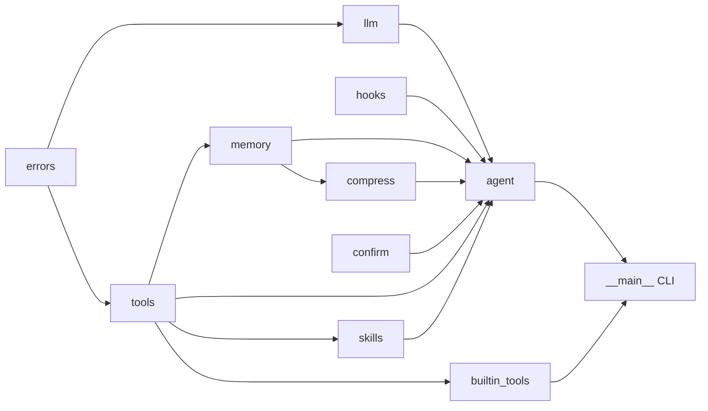
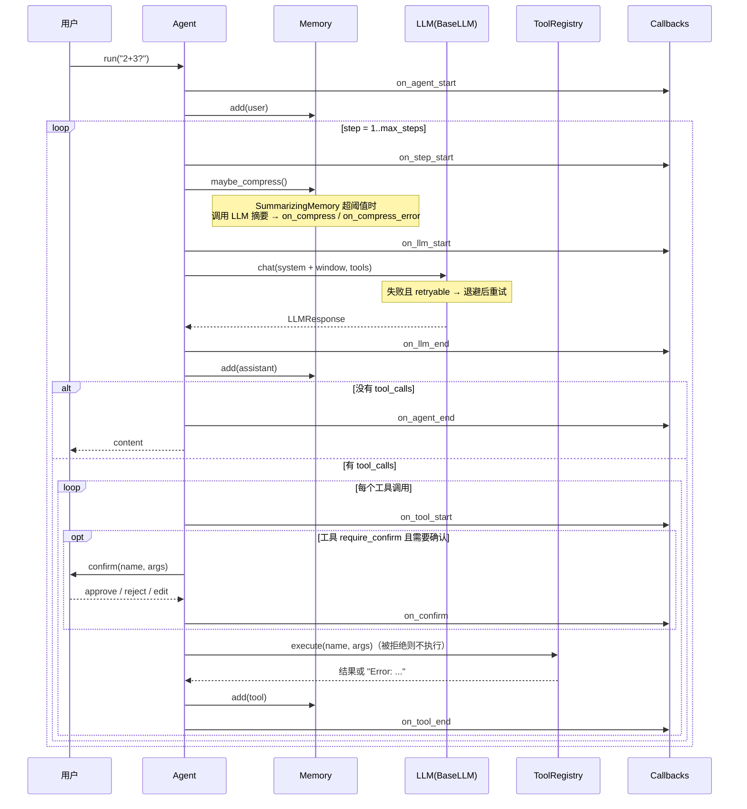

# 架构设计说明

## 1. 模块依赖



依赖是单向的：`errors` 最底层，`agent` 最上层。每个模块都可以单独阅读、单独测试。

## 2. 一次 run 的时序



## 3. 关键设计决策

| 决策 | 原因 |
|---|---|
| 消息直接用 OpenAI 格式的 `dict` | 零学习成本；可直接 `json.dumps` 持久化；与绝大多数服务兼容 |
| 重试放在 `BaseLLM.chat`，子类只实现 `_chat_once` | 重试与传输方式无关；MockLLM 也能复用，从而可以离线测试重试逻辑 |
| 异常带 `retryable` 类属性 | 重试判断只有一行 `if not e.retryable`，新增错误类型时无需改重试代码 |
| `sleep` 可注入 | 测试中不真正等待，同时还能断言退避时长 |
| 工具执行永不抛异常 | 工具错误是"模型可以修正"的信息，应回传给模型而不是让程序崩溃 |
| LLM 错误重试后**会**抛出 | 与工具错误相反，这是"模型无法修正"的错误，应交给调用方决策 |
| system prompt 不进记忆 | 截断永远不会丢失系统指令；切换 prompt 不需要改历史 |
| 截断后从 `user` 消息开始 | 保证 `assistant(tool_calls)` 与 `tool` 消息成对出现，避免 API 400 |
| 回调异常被吞掉 | 可观测性代码不应影响业务流程 |
| 子 Agent 每次调用使用新记忆 | 子任务之间互不污染；父 Agent 通过 task 参数传递全部上下文 |
| 技能 = 目录常驻 + 正文/资源按需加载 | 渐进式披露：技能再多，system prompt 也只增加一行/个；没用到的技能零成本 |
| 技能通过普通工具（load_skill / read_skill_file）加载 | 不需要改 Agent 循环；技能内容以 `tool` 消息进入历史，记忆/截断/持久化/钩子全部复用 |
| 重复 load_skill 仍返回完整正文 | 早先加载的正文可能已被记忆窗口截断，宁可多花点 token 也不能让模型"失忆" |
| 手写 frontmatter 解析 | 坚持零依赖；只支持需要的 YAML 子集，代码 30 行可读完 |
| `read_skill_file` 用 realpath 校验 | 同时防住 `../`、绝对路径和指向外部的符号链接 |
| 技能不自动执行脚本 | 执行任意代码风险高；需要时请显式写受限工具 |
| 压缩通过 `memory.maybe_compress()` 扩展点接入 | Agent 不需要知道压缩细节；基础记忆是空实现，自定义记忆可以实现任意策略 |
| 记忆通过 `attach(llm, emit)` 拿到 LLM 和钩子 | 避免记忆反向依赖 Agent；摘要模型可单独指定（更便宜的模型） |
| 只在 user 消息处切分、当前轮永不压缩 | tool_call/tool 永远成对；多步工具调用中途压缩也安全 |
| 摘要增量更新（旧摘要 + 新对话 → 新摘要） | 多次压缩不会"摘要的摘要"层层丢信息 |
| 摘要以 user+assistant 一问一答注入 | 不污染 system prompt（职责分离 + 降低注入风险）；角色交替合法 |
| 摘要失败不抛异常、同一轮不重试 | 压缩是优化而非必需；退回窗口截断即可，避免每步都打一次故障接口 |
| 确认发生在 Agent 而非 ToolRegistry | 确认需要"人"和钩子，属于编排层；ToolRegistry 保持纯粹，直接调用工具函数也不受影响 |
| 未配置确认处理器 = 拒绝 | 安全默认值：遗漏配置不应变成全部放行 |
| 拒绝也写 tool 消息（以 Error: 开头） | 保持配对；与其他工具错误同一格式，模型已有处理经验 |
| edit 后在结果中注明实际参数 | 历史中的 tool_call 仍是原参数，否则模型会误以为按原参数执行了 |

## 4. 技能（Skills）的位置

技能不是一个新的"运行时组件"，而是**提示词组织方式 + 两个工具**：

```
Agent.__init__(skills=reg)
   ├─ system_prompt += reg.prompt_section()     # 第1层：目录 + 使用规则
   └─ tools.register(reg.as_tools(on_load=...)) # load_skill → 第2层；read_skill_file → 第3层
                                                # on_load 回调 → agent.loaded_skills + on_skill_load 钩子
```

因此 Agent 主循环一行都不用改：模型调用 `load_skill` 和调用任何其他工具走的是同一条路径。

## 5. 上下文压缩与人工确认的位置

两者都没有改变主循环的结构，只是挂在已有的两个点上：

```
Agent._build_messages()        ← memory.maybe_compress()  （上下文压缩）
Agent._run_tool()              ← _check_confirm()          （人工确认）
```

## 6. 错误处理全景

```
                     ┌────────────── 工具层 ──────────────┐
模型给了坏参数/工具崩溃 → ToolRegistry.execute → "Error: ..." → 回给模型自我修正

                     ┌────────────── 模型层 ──────────────┐
网络/超时/429/5xx/坏响应 → retryable=True  → 指数退避重试 → 仍失败 → 抛给调用方
401/403/400/404      → retryable=False → 立即抛出（附带服务端 body）

                     ┌────────────── 循环层 ──────────────┐
一直调用工具不收敛    → max_steps → 强制要答案 / MaxStepsExceeded

未知技能 / 资源越界   → "Error: ..." + 可用技能/文件列表 → 回给模型
用户拒绝 / 确认出错   → "Error: 用户拒绝执行…原因…"     → 回给模型调整方案

                     ┌────────────── 记忆层 ──────────────┐
摘要 LLM 出错/空摘要  → on_compress_error → 本轮窗口截断兜底，下一轮再试

                     ┌────────────── 观测层 ──────────────┐
回调本身出错          → CallbackManager 记日志后忽略
```

## 7. 有意不做的事（保持 minimal）

- 异步 / 并行工具执行（README FAQ 给了改造思路）
- 向量检索（`JSONStore.search` 是朴素子串匹配，可替换）
- 精确的 token 计数（`estimate_tokens` 按中文/英文粗略估算；需要时可接入 tokenizer）
- 异步审批（确认处理器是同步阻塞的；Web 审批可在处理器内部等待结果）
- 多模态、结构化输出解析器等高级特性
